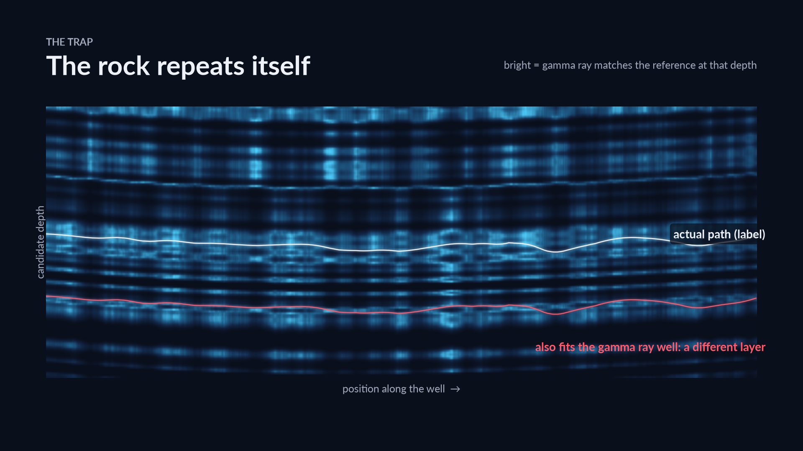
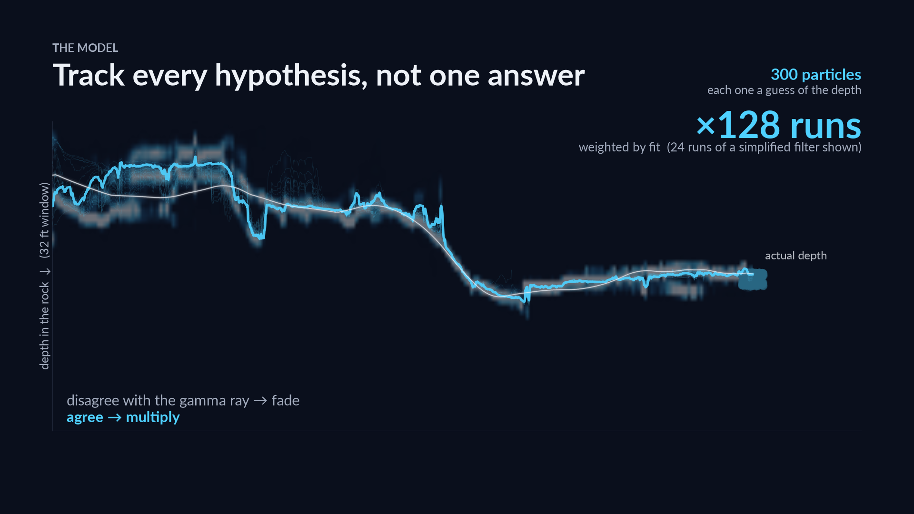
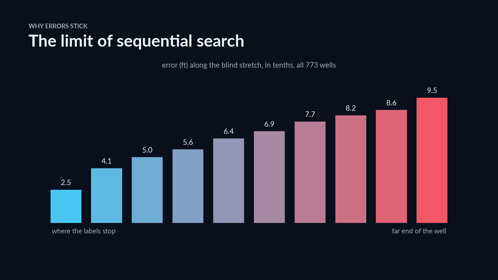

# geosteer

A state-space (sequential Monte Carlo) model that tracks where a horizontal well sits in the rock
layers, foot by foot, from its gamma-ray log. It won a solo silver medal in the ROGII Wellbore
Geology Prediction competition: rank 125 of 6,191 teams, private RMSE 7.819 ft. The filter tracks
the structural datum u = TVT + Z rather than TVT itself, and scores each hypothesis on both the
gamma-ray level and its slope along the well, linked by the chain rule.

[](docs/method.mp4)

▶ Video: how the method works

## The problem

A horizontal well runs sideways for a mile or more inside a target layer. The only live signal
about the rock is the gamma-ray (GR) log. A nearby vertical typewell gives the reference: GR as a
function of stratigraphic depth, TVT. TVT is given on the first part of each well; the task is to
predict it for the rest, scored by RMSE in feet. The GR pattern is quasi-periodic, with look-alike
beds roughly 8–20 ft apart in TVT, so several depths match almost equally well, and a wrong choice
shifts the rest of the well by a whole cycle.

## Approach

1. **Neighbour marker surface.** Training wells with known TVT give points on the structural
   surface S = Z + TVT; interpolated at this well's position, it is a GR-free estimate that also
   enters the filter as sparse observations.
2. **Particle filter.** 128 independent runs of 300 particles, each particle carrying (u, du/dMD),
   scored by a GR-level term and a GR-slope (flank) term. Over the depth range its heel covers,
   the well's own log replaces the typewell as reference when it fits better and its runs agree
   more closely.
3. **Gated blend.** The filter, the genealogy smoother and the marker-observed filter are
   regularised and mixed, then blended with two members whose errors are partly independent of the
   filter's: the neighbour-well surface and a plane-guided HMM, weighted by how close the
   neighbouring wells are.
4. **Whole-well shape decoder.** A forward-backward pass over a smooth offset to the stacked path,
   applied only where its posterior is confident.
5. **Final steps.** Heel taper, parallel-neighbour correction and start continuity.



Design choices:

- **Island particle filter.** 128 independent filters give the right cycle several chances and
  are combined by softmax of their marginal log-likelihoods (T = 2).
- **u = TVT + Z.** Layers change slowly in u, and the fast variation of TVT comes from the
  surveyed trajectory, so the filter tracks a slowly drifting surface.
- **Own-log confidence gate.** The filter also runs with the well's own heel log as reference
  and switches to it only where that version fits better and its runs agree more closely. On the
  competition's hidden wells, adding this gate alone took RMSE from 8.488 to 7.866 ft.
- **Slope term from the chain rule.** dGR/dMD = G′(TVT)·(du/dMD − dZ/dMD): for a given direction
  of travel, two depths with the same GR level on opposite flanks of a bed predict opposite
  slopes, so the slope term tells them apart.

## Results

| | |
|---|---|
| Competition (medal entry: average of two variants of this filter) | private RMSE 7.819 ft, rank 125 / 6,191 |
| Baseline: hold the last known depth, out of fold, 773 wells | pooled RMSE 15.91 ft |
| Out of fold, 773 training wells (competition champion, start continuity applied afterwards) | pooled RMSE 6.734 ft |
| Median per-well RMSE, out of fold (competition champion, before start continuity) | 3.98 ft |

This is the competition code, reorganised and cleaned up for reading.

The slope term cut out-of-fold RMSE from 7.389 to 6.831 ft on all 773 wells (pipeline at that
time, before the final decoder). Out-of-fold means each training well is predicted like a test
well: only its heel is visible, and its own points are removed from every neighbour cloud.
Gains were confirmed on all 773 wells, not on samples: a 500-configuration sweep that gained
1.90 ft on 80 wells turned out 0.93 ft worse on all 773.

## Error analysis

From `results/oof_per_well.csv` (per-well aggregates of the competition champion's out-of-fold
predictions, all 773 wells; reproduced by `python -m geosteer.analysis`):

| | |
|---|---|
| Pooled RMSE (before start continuity) | 6.763 ft |
| Wells with RMSE over 10 ft | 80 (10.3%), holding 56.3% of the squared error |
| Squared error from a constant offset / a linear dip error / the rest | 55.8% / 21.2% / 23.0% |
| Offset + linear dip together | 77.0% |

[](docs/limits.mp4)

▶ Video: where the model breaks, and what's next

- Error grows along the blind stretch (2.52 → 9.49 ft), partly as for any extrapolation away from
  the last label; a sequential filter also rarely recovers once resampling has pruned the right
  cycle.
- On the 80 wells over 10 ft, I scored the true path and the prediction under the filter's own model
  (typewell reference; gamma-ray level and slope terms plus the AR(1) dip-rate prior, with the
  latent rate integrated out exactly). The model itself prefers the true path on 56 of 80 (search
  errors) and the prediction on 24 (model errors) (`geosteer.analysis --model-score`).

Also explored:

- U-Nets on the evidence image (cross-entropy, signed-distance and filter-residual targets); the
  filter stayed ahead, so it shipped.
- A neural ranker over the filter's candidate paths; I traced most of its out-of-fold gain (0.23 of
  0.26 ft) to a leak (the label-nearest path had been added to each candidate set) and dropped it.

## Next steps

- Search is the main failure (56 of the 80 worst wells): next, interacting islands or backward
  re-weighting, so that a wrong cycle can still be revised.
- **With more time:** pre-train a whole-well U-Net on synthetic wells generated in u = TVT + Z
  space and feed it the filter's posterior and the slope evidence; it could also learn faults,
  which the smooth AR(1) dip prior cannot.

## How to run

Download the data from the competition page (it is not redistributed here):
<https://www.kaggle.com/competitions/rogii-wellbore-geology-prediction/data>. Unzip it so that
`DATA/train/`, `DATA/test/` and `DATA/sample_submission.csv` exist.

```bash
pip install -e ".[test]"          # ".[analysis]" adds matplotlib for --plot

pytest                                               # data-free checks and a fake-data run
geosteer-predict --data DATA --out submission.csv --workers 4
geosteer-evaluate --data DATA --wells 50 --workers 4 --save-preds oof.npz
python -m geosteer.analysis                           # error analysis from results/
python -m geosteer.analysis --model-score oof.npz --data DATA
```

On one core the pipeline takes a few minutes per well; 16 wells take about 6–15 minutes on 4
workers, depending on the machine.

## Repository map

```
geosteer/
  config.py           all model constants, with what each controls
  particle_filter.py  numba kernels (level + slope emissions, marker observations),
                      genealogy smoother, island ensemble
  stages.py           neighbour marker surface, EM-plane member, whole-well shape decoder,
                      shape regulariser and final corrections
  pipeline.py         the ordered per-well stages, data loading, out-of-fold evaluation,
                      submission writer, geosteer-predict / geosteer-evaluate
  analysis.py         error analysis from results/oof_per_well.csv
results/oof_per_well.csv   per-well out-of-fold aggregates, 773 wells
tests/test_geosteer.py     synthetic-well checks, a fake-data run, README numbers vs results/
docs/                      figures and videos
```

MIT licence
